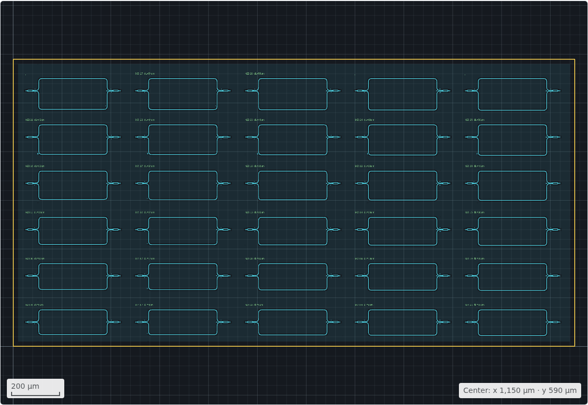
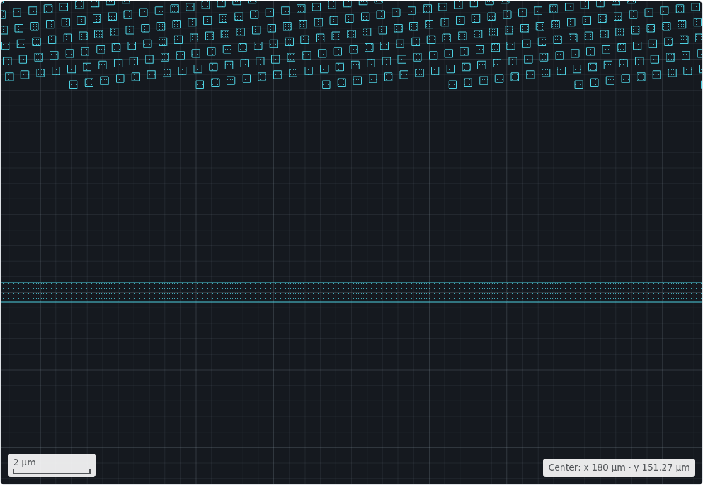

# Generate a 30-MZI chip

The example builds a hierarchy of 30 Mach–Zehnder interferometers in a 5 × 6 array. It uses PCells for reusable geometry and writes a CSV with each device's position and path length difference. The MMI geometry is illustrative and requires foundry validation before fabrication.

Run from the repository root. Keep `scratch` in the current shell for the viewer command.

```sh
scratch="$(mktemp -d)"
export MASKYARD_DATABASE_URL="sqlite:///$scratch/chip.db"
uv run --locked python examples/chip_30_mzis.py --output "$scratch/chip.gds"
uv run --locked --extra web uvicorn maskyard.web:app
```

The script writes `chip.gds` and `chip.csv` to the scratch directory. Open <http://127.0.0.1:8000/>, select the saved cell from the `chip` factory, and use **Fit layout** to see the whole array.



## How the script adds fill { #adding-fill }

The `chip()` factory builds the base hierarchy. Running the script calls `main()`, which uses `top.fill()` to add 200 nm square fill cells with a 5 µm clearance around the waveguides before exporting the GDS. The guard skips fill generation if the saved chip already contains it.

```python
--8<-- "chip_30_mzis.py:chip-fill"
```

At whole-chip scale, the viewer shows dense fill as a shaded coverage preview. Zoom in beside a waveguide to see the individual squares and the clearance around it.


