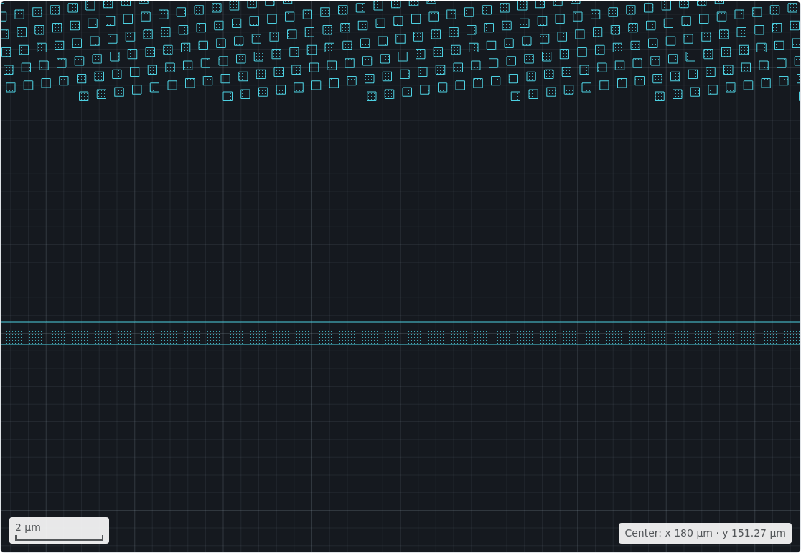

# 生成含 30 个 MZI 的芯片

示例生成一个包含 30 个马赫–曾德尔干涉仪的层次化版图，阵列为 5 列 6 行。示例用 PCell 复用几何图形，并将每个器件的位置和光程差写入 CSV。示例中的多模干涉耦合器（MMI）几何仅用于演示，流片前需由晶圆厂验证。

在仓库根目录执行以下命令。启动查看器时请使用同一个终端，以保留 `scratch` 变量。

```sh
scratch="$(mktemp -d)"
export MASKYARD_DATABASE_URL="sqlite:///$scratch/chip.db"
uv run --locked python examples/chip_30_mzis.py --output "$scratch/chip.gds"
uv run --locked --extra web uvicorn maskyard.web:app
```

脚本将 `chip.gds` 和 `chip.csv` 写入临时目录。打开 <http://127.0.0.1:8000/>，选择 `chip` PCell生成的单元，然后点击 **Fit layout**，即可查看完整阵列。


## 脚本如何添加填充 { #adding-fill }

`chip()` PCell 函数创建芯片的基础层次结构。运行脚本会调用 `main()`，它在导出 GDS 前用 `top.fill()` 添加边长为 200 nm 的方形填充单元，并在波导周围留出 5 µm 的间距。如果数据库中的芯片已包含填充，脚本会跳过这一步。

```python
--8<-- "chip_30_mzis.py:chip-fill"
```

查看整片芯片时，查看器用浅色阴影显示密集填充的大致覆盖范围。放大波导附近的区域，即可看到单个填充方块及波导周围的间距。


